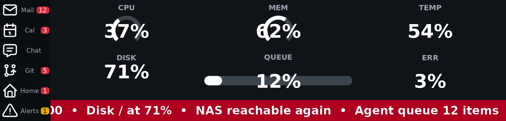

# smart-panel

Drive a HOTSPOTEK USB HID bar display (a 9.16" IPS panel sold white-label via
mirabox.key123.vip / yeahmagicgaming.com) directly from Python, and turn it into
a managed, always-on status board: a news-style **crawl**, **gauges** for system
health, real-time **alerts** pushed by an agent or any local process, and a
**sidebar** of app icons with count chips.

The project ships two Python packages in one distribution:

- **`panel_driver`** — a minimal transport library: reverse-engineered USB HID
  framing, the init sequence, orientation, and the frame loop. It depends only
  on `hid` and `Pillow`.
- **`smart_panel`** — the application layer built on top of the transport: a
  long-running **runner** that composes a 1920×462 canvas from plugin regions
  and pushes it through a pluggable sink (real panel, PNG files, or null), a
  **plugin SDK** and loader, a **CLI** that is a thin client of a local
  Unix-socket control channel, and a durable SQLite state store.

The four requested features (alerts, crawl, gauges, sidebar) ship as built-in
plugins that use the same extension contract available to third parties, so the
core contains no feature-specific logic.

## Supported hardware

| Property | Value |
|---|---|
| USB VID / PID | `0x5548` / `0x1011` |
| USB string descriptor | `HOTSPOTEKUSB HID DEMO` |
| Interface / endpoint | HID (`0x03`), endpoint `0x01`, OUT, interrupt |
| Native display buffer | 462 × 1920 (portrait); the app presents a 1920 × 462 landscape canvas and rotates internally |
| Supported hosts | Raspberry Pi OS / Linux, and macOS |

Protocol facts (header layout, init sequence, open questions) are captured in
[`handoff/panel_protocol_handoff.md`](handoff/panel_protocol_handoff.md). That
document is the source of truth for anything on the wire; read it before
changing `panel_driver/`.

## Install

Python 3.11 or newer is required.

```bash
git clone https://github.com/hortocam/smart-panel.git
cd smart-panel
python3 -m venv .venv && source .venv/bin/activate
pip install -e ".[dev]"
```

`pip install -e .` installs the transport with only the `hid` and `Pillow`
runtime dependencies. Two extras are available:

- **`app`** — adds the application-layer dependencies `psutil` (system metrics)
  and `defusedxml` (safe RSS/Atom parsing): `pip install -e ".[app]"`.
  `panel_driver` never imports them.
- **`dev`** — everything the test suite needs (`pytest`, `ruff`, `psutil`,
  `defusedxml`): `pip install -e ".[dev]"`.

### Linux: let your account open the panel (udev rule)

By default `hidraw` devices are owned by `root`, so a normal account cannot
open the panel. Install the bundled udev rule:

```bash
sudo cp packaging/99-smart-panel.rules /etc/udev/rules.d/
sudo udevadm control --reload && sudo udevadm trigger
```

The rule is exactly:

```
SUBSYSTEM=="hidraw", ATTRS{idVendor}=="5548", ATTRS{idProduct}=="1011", TAG+="uaccess", GROUP="plugdev", MODE="0660"
```

- `TAG+="uaccess"` grants the user sitting at the seat (the interactive
  desktop/login user) access to the device.
- `GROUP="plugdev"` grants a **headless service account** access: add the
  account that runs the runner to the `plugdev` group
  (`sudo usermod -aG plugdev <service-account>`), then log out and back in (or
  reboot) for the group membership to take effect.
- `MODE="0660"` is deliberately **not** world-writable (`0666`). A world-
  writable device node would let any local account open the panel directly and
  bypass the CLI access policy (FR-051), which is enforced by the runner over
  the control channel, not by file permissions alone.

Replug the panel after reloading udev so the new permissions apply.

## Usage

The CLI is the display's only control surface; everything that affects the
display can be inspected and changed through it, with a machine-readable output
mode for agents.

```bash
smart-panel start                 # start the runner in the background
smart-panel --json status         # runner, panel, fps, plugin health, spool depth
smart-panel plugin list           # built-in and discovered plugins
smart-panel alert push --severity warning --title "Disk" --message "nas01 at 91%"
smart-panel preview --output /tmp/board.png   # render the canvas to a PNG (no panel needed)
smart-panel stop
```



*The default 1920×462 layout from `smart-panel preview` with the file sink, no
panel attached: a 192 px sidebar with five entries plus the built-in alert chip,
six gauges over the main region, and the news-style crawl along the bottom. A
live alert covers the main region for its duration; the chip counts the alerts it
missed.*

### A quick tour, from an empty setup to a full display

Every step is a CLI command, and every command accepts `--json` with a stable
envelope and documented exit codes, so an agent can build the whole display
without touching a file:

```bash
# Runner, layout and a first region
smart-panel start --sink files --files-dir "$SMART_PANEL_HOME/frames"
smart-panel plugin instance add hello --plugin text --set text=Hello
smart-panel layout region set main --x 0 --y 0 --w 1920 --h 462 --instance hello

# Gauges fed by the system source (FR-031 to FR-036)
smart-panel data source add --id sys --type system \
    --settings '{"metrics": ["cpu", "mem", "temp", "disk:/"]}'
for g in cpu mem temp disk; do
  smart-panel gauge add --id "$g" --label "${g^^}" --topic "sys.$g" \
      --aggregation avg --window 60 --style dial
done
smart-panel gauge push queue 42          # a gauge fed by an agent, not by psutil

# News crawl from a feed, with fall-back items (FR-025 to FR-030)
smart-panel crawl source add --id news --kind rss --preset google-news-topic --topic TECHNOLOGY
smart-panel crawl items set "Backup finished" "Disk / at 71%"

# Sidebar with app icons and count chips (FR-037 to FR-041)
smart-panel sidebar entry add --id mail --icon mail --label Mail --topic count.mail
smart-panel sidebar count set mail 1204      # the chip shows 999+

# Alerts pushed by an agent (FR-017 to FR-024)
smart-panel alert push --severity critical --title "UPS" --message "On battery" --id ups-1
smart-panel alert list --state displayed
smart-panel alert resolve --id ups-1

smart-panel preview --output /tmp/board.png  # what the panel would show, no panel needed
smart-panel stop
```

A push-type command (`alert push`, `gauge push`, `sidebar count set`,
`crawl items set`, `data push`) sent while the runner is down is saved and replayed
on the next start, and answers `{"saved_for_later": true}` instead of failing.

### Discoverability for agents

`smart-panel schema` prints one JSON document describing the whole surface — the
control commands, the CLI-local lifecycle commands, the exit-code table, and every
plugin verb with its arguments (SC-008), so an agent can discover the display
without reading this file. `smart-panel --json status` reports each plugin
instance's health, the panel state, the measured frame rate and the spool depth.

### Extending the display

The four features ship as plugins that use the same extension contract available
to third parties, so a new widget is a drop-in file or an installed package:
[`docs/plugin-authoring.md`](docs/plugin-authoring.md) covers the manifest, the
settings, the render rules, plugin verbs, data and alert-source plugins, the
`sdk.testing` harness, and the entry-point packaging snippet.
`examples/plugins/clock.py` is a complete worked example.

End-to-end validation scenarios (A–H without a panel, and the Raspberry Pi
hardware scenarios P1–P4) live in
[`specs/001-status-display-platform/quickstart.md`](specs/001-status-display-platform/quickstart.md).

## Security and limits

- **Local-only control channel.** The runner serves a Unix domain socket at
  `$SMART_PANEL_RUNTIME` (default `/tmp/smart-panel/control.sock`); there is no
  network listener. Every connection is authorized by kernel peer credentials —
  `SO_PEERCRED` on Linux, `LOCAL_PEERCRED` on macOS (the macOS path is
  implemented but has not been exercised on real hardware) — allowing the
  runner's own account, root, and any account or group the owner adds with
  `access allow-user` / `access set-group`. Everyone else gets exit code 5 and the
  attempt is logged. `access.*` and `secret.*` are accepted only from the
  runner's account or root, and the CLI refuses a socket owned by anyone other
  than itself, root, or `$SMART_PANEL_RUNNER_UID`.
- **Secrets stay in `secrets.json`.** `secret set NAME` (value read from stdin,
  never argv) writes `<home>/secrets.json` mode 0600; config refers to the value
  as `${secret:NAME}`. No command echoes it, `config show` redacts it, and the
  runner's logger masks every registered value, so a secret cannot leak through
  `status`, `logs` or an error message (FR-049).
- **The spool lives in the temp directory.** A push made while the runner is down
  waits in `<runtime>/spool`, under `/tmp` by default, so a reboot clears it; a
  disk-backed spool is one command away (`config set paths.spool DIR`). Each entry
  is checked against the access policy by its owner uid before replay, malformed
  and oversize (> 64 KiB) entries are rejected, and the directory is capped at
  1,000 files.
- **In-process plugin isolation has limits.** A plugin that raises, returns the
  wrong size or type, or blocks past its deadline is marked `degraded` or
  `stalled` and every other region keeps rendering — but a thread cannot be
  killed, so a plugin stuck in a busy loop keeps burning CPU until the runner is
  restarted. Out-of-process plugins remain a future option
  ([`research.md`](specs/001-status-display-platform/research.md) decision 4).
- **Hostile text is bounded plain text.** Alert messages, crawl items and sidebar
  counts are stripped of control characters, capped in length (280 characters;
  longer crawl items end with an ellipsis), drawn as literal text — markup is
  never interpreted — and counts above `max_display` are abbreviated to `999+`.

## Development

```bash
pip install -e ".[dev]"
ruff check .                 # must be clean
pytest -m "not hardware"     # `hardware`-marked tests need the physical panel and are skipped by default
python scripts/profile_frame.py   # compose+encode median and p95 for a full frame (SC-005)
```

The suite is split by layer: `tests/unit/` (pure logic — protocol, encoder,
settings, aggregation), `tests/contract/` (the CLI envelope, the control
protocol, the plugin SDK and each built-in's verbs), `tests/integration/` (a real
runner on the file/null sink driven through the real CLI), and `tests/hardware/`
(marked `hardware`, skipped by default because no panel exists in CI). CI runs
`ruff check .` and `pytest -m "not hardware"` on Linux and macOS with Python 3.11
and 3.13.

Hardware tests must be skipped, not faked; no panel is available in CI. On a
Raspberry Pi the runner can run unattended as a user service
(`smart-panel service install`, then `loginctl enable-linger`).

## Contributing

`main` is **protected**: all changes arrive through a **pull request** — nothing
is pushed to `main` directly, force pushes and branch deletion are disabled, and
the required CI checks must pass. A pull request describes what changed and why,
states how it was tested (including hardware verification where relevant), and
records the constitution check.

The project constitution
([`.specify/memory/constitution.md`](.specify/memory/constitution.md)) governs
spec-driven work; its principles are the acceptance bar, not decoration.
Contributions must follow the
[Code of Conduct](CODE_OF_CONDUCT.md).

## License

MIT — see [LICENSE](LICENSE). Bundled third-party assets and their licenses are
recorded in [THIRD_PARTY_NOTICES.md](THIRD_PARTY_NOTICES.md).
